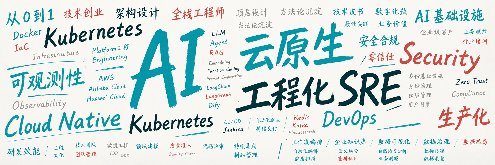

## Hi, I'm @qianfeiqianlan

**Compute infrastructure will be the basis for the economy of the future.**

连续创业者，10年+全栈技术经验，多年产研团队管理经验，擅长云原生架构，DevOps 流程优化、SRE 体系建设，曾主导千万级用户产品的平台架构演进优化

   

<!--  -->

## About Me

连续创业者、全栈工程师、技术创业者，长期关注 **AI Infrastructure、AI Agent、AI Coding** 等前沿领域。

前 ThoughtWorks 高级咨询师、前百度高级工程师，擅长DevOps、SRE、云计算基础设施、身份基础设施和 AI 基础设施等技术领域。

多年团队管理经验，擅长打造精益、自驱、创业氛围团队，具有丰富的团队管理能力。

## Tech Stack

**AI Infra**  
       

**DevOps**  
      

**Language**  
          

## Stats

  
  

  

---
<!--  -->
